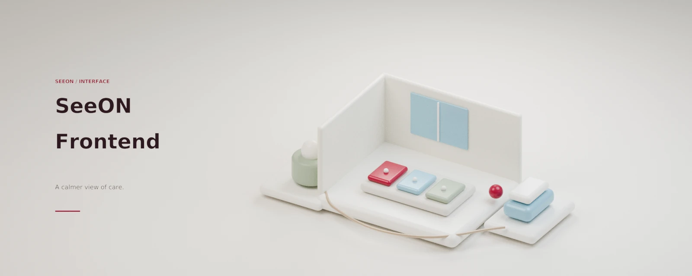

<p align="center">
  
</p>

<p align="center"><sub>SENIOR AI LAB · SEEON</sub></p>

<h1 align="center">SeeON Front</h1>

<p align="center">
  <strong>돌봄 현장에서, 지금 확인할 곳을 선명하게.</strong><br />
  시설의 방·공간 상태와 알림을 직원과 관리자에게 전달하는 웹 대시보드.
</p>

<p align="center">
  <a href="#빠른-시작">빠른 시작</a> ·
  <a href="#화면과-기능">화면과 기능</a> ·
  <a href="./docs/architecture.md">아키텍처</a> ·
  <a href="#운영과-보안-경계">운영과 보안</a> ·
  <a href="#문서">문서</a>
</p>

SeeON Front는 AI 분석 결과와 시설 데이터를 현장 친화적인 카드·알림으로 보여주는 **Vite + React SPA**입니다. 이 저장소는 브라우저 UI와 백엔드 API 연결을 담당하며, 영상 분석·데이터 저장·최종 권한 판정은 담당하지 않습니다.

| 사용자 | 화면 |
| --- | --- |
| `STAFF` | 시설 대시보드, 층별 모니터, 알림 처리 |
| `ADMIN` | 이벤트 상세, 시설·공간·사용자 및 모니터·알림 설정 |
| `SUPER_ADMIN` | 시설 선택과 엣지 등록 관리 등 상위 운영 화면 |

## 배포 범위

[`vercel.json`](./vercel.json)은 Vite 빌드 산출물 `dist`와 SPA 경로 재작성 규칙을 정의합니다. 이는 정적 프런트엔드 호스팅 구성이지, API 연결이나 배포 성공을 증명하지 않습니다. 이 저장소는 Vercel 정적 배포만으로 **전체 제품 준비 상태**를 주장하지 않습니다.

독립 프런트 저장소에는 실행 중인 백엔드나 Docker/nginx API 프록시가 포함되어 있지 않습니다. 이전 추출·전환과 제거된 런타임 파일의 이력은 [MIGRATION.md](./MIGRATION.md)를 참고하세요.

실제 Production URL에서 HTTPS API, CORS와 쿠키, 로그인, SSE, 업로드, 미디어 Range 요청, RBAC를 검증하기 전에는 `STATIC_READY`를 넘어선 제품 준비 상태를 선언하지 마세요. 기준과 전환 이력은 [MIGRATION.md](./MIGRATION.md)에서 확인합니다. Vercel 재작성은 API 프록시가 아닙니다.

## 빠른 시작

프런트엔드 저장소 루트에서 실행합니다. 다음 도구 버전은 [`package.json`](./package.json), [`.nvmrc`](./.nvmrc), CI 설정을 따릅니다.

- Node.js `24.x`
- Corepack으로 활성화한 `pnpm@10.32.1`
- 별도 실행 중인 SeeON 백엔드 API. 개발 서버의 기본 `/api` 프록시 대상은 `http://localhost:8080`입니다.

```bash
corepack enable
corepack prepare pnpm@10.32.1 --activate
pnpm install --frozen-lockfile
pnpm dev
```

Vite 개발 서버는 `http://localhost:3000`에서 실행됩니다. 로컬 API가 다른 주소에 있다면 `.env.example`을 `.env.local`로 복사하고 `VITE_DEV_BACKEND_ORIGIN`을 해당 로컬 API 주소로 조정하세요. 기본 API 경로는 `/api/v1`입니다. `.env.local`에 비밀값이나 운영 자격 증명을 넣거나 커밋하지 마세요. 백엔드 실행 방법과 계정은 [SeeON-Backend 저장소](https://github.com/SeniorAILab/SeeON-Backend)의 안내를 따릅니다.

백엔드가 연결되지 않아도 프런트 개발 서버는 뜰 수 있지만, 로그인과 API 데이터는 사용할 수 없습니다. 런타임 mock 계정이나 샘플 성공 경로는 없습니다.

저장소에 정의된 주요 확인·빌드 명령:

```bash
pnpm typecheck
pnpm lint
pnpm test
pnpm build
pnpm preview
```

실행 명령은 [`package.json`](./package.json)에 정의되어 있으며, GitHub Actions는 고정 lockfile 설치 후 `typecheck`, `lint`, `test`, `build`를 실행합니다([CI workflow](./.github/workflows/ci.yml)). 이 문서는 위 명령을 이번 문서 작업에서 실행했다는 뜻이 아닙니다.

## 화면과 기능

### 직원 화면

시설 스코프를 갖는 주요 경로는 다음과 같습니다.

- `/facilities/:facilityId/dashboard` — 전체 공간 모니터
- `/facilities/:facilityId/floors` — 층 선택
- `/facilities/:facilityId/floor/:floorId` — 특정 층 모니터
- `/facilities/:facilityId/alerts` — 알림 목록과 처리

직원 화면은 공간 상태·요약·카메라 신선도를 구분해 보여줍니다. 알림 목록은 `NEW`와 `ACKED`를 처리할 항목으로, `RESOLVED`를 처리된 항목으로 표시합니다. 경로는 역할과 시설 스코프를 위한 UI 가드이며 서버 권한 검사를 대체하지 않습니다.

### 층별 모니터

대형 화면과 최소 조작을 위한 모니터는 대시보드 데이터, SSE 이벤트, 알림 REST 조회를 결합합니다. 위험 상태(`STABLE`, `CAUTION`, `DANGER`, `CHECK_NEEDED`)와 카메라 연결 신선도(`LIVE`, `STALE`)는 서로 다른 축입니다. 연결 정보가 오래됐다고 위험 상태가 정상이라는 뜻은 아닙니다.

음성 안내는 브라우저 `SpeechSynthesis`를 사용하며, 첫 재생은 브라우저 사용자 제스처 정책의 영향을 받습니다. 모니터 설정은 브라우저의 로컬 설정으로, 시설 서버 설정과 동일하다고 가정하지 마세요.

#### 현장 모니터 운영 메모

- 직원용 문구는 상태와 다음 행동을 쉬운 한국어로 안내하고, 공간은 확인 우선순위(`DANGER` → `CHECK_NEEDED` → `CAUTION` → `STABLE`)로 정렬합니다. 화면 글자 크기 기준은 `DESIGN.md`의 직원용 서체 규칙(공간명 28px, 상태 24px, 설명 19px)을 참고하세요.
- 벽면 모니터의 조작은 층 선택, 새로고침, 전체 화면, 소리 전환처럼 현장 사용에 필요한 항목에 집중합니다. 끊긴 카메라 수와 최근 데이터 연결 상태는 위험 표시와 별도로 볼 수 있습니다.
- 모니터 알림 소리는 기본 활성화 설정이며, 브라우저가 소리를 차단할 수 있습니다. 진동은 지원하는 브라우저에서만 동작합니다. 브라우저 음성 안내의 첫 재생도 사용자 제스처가 필요할 수 있습니다.

### 관리자 화면

`/facilities/:facilityId/admin/*` 아래에 이벤트 목록·상세, 시설, 공간, 사용자, 모니터·알림 설정이 있습니다. 엣지 등록 관리 화면은 `SUPER_ADMIN` 권한이 추가로 필요합니다. `/dashboard/*`와 `/admin/*`는 새 화면을 추가하는 경로가 아니라 기존 경로를 보내는 redirect 전용 경로입니다.

이벤트 상세의 근거 영상은 실시간 CCTV 관제 기능이 아닙니다. 브라우저는 백엔드가 제공하는 이벤트 미디어 상태를 표시하고, 허용된 경우 인증된 콘텐츠 URL을 사용합니다. 이용 가능 여부·접근 권한·보관 기간·Range 요청 처리는 백엔드와 배포 환경에 달려 있습니다.

## 운영과 보안 경계

- 로그인과 세션은 백엔드가 소유합니다. 브라우저는 httpOnly `app_session` JWT 쿠키를 사용하고 `/api/v1/auth/me`로 세션을 복원합니다. 프런트 `localStorage`는 인증 세션의 원본이 아닙니다.
- 일반 HTTP API 요청은 `src/services/`를 통합니다. 컴포넌트에서 백엔드를 직접 호출하거나 wire DTO를 UI에 퍼뜨리지 않습니다. HTTP 계약의 단일 기준은 백엔드 OpenAPI입니다([CONTRACT.md](./CONTRACT.md)).
- 선택된 시설은 HTTP 요청의 `X-Facility-Id`, SSE URL의 `facilityId`로 전달될 수 있습니다. 시설 스코프와 최종 RBAC 검증은 백엔드 책임입니다.
- Production에서 API를 연결한다면 `VITE_API_BASE_URL`을 절대 HTTPS URL로 설정해야 합니다. 미설정 빌드는 정적 shell을 만들 수 있을 뿐 API 연결을 보장하지 않습니다. `VITE_*` 값은 브라우저 번들에 포함될 수 있으므로 비밀값·토큰을 저장하지 마세요. HTTPS 페이지에서 HTTP API를 호출하지 마세요.
- 원본 카메라 스트림을 이 프런트에서 보여주는 것으로 설명하지 마세요. 현장 UI에 모델 점수·카메라 ID·내부 모델 설명을 노출하거나 얼굴 인식 기능을 추가하지 않습니다.
- API 오류, 권한 거부, 미디어 부재는 mock 성공으로 바꾸지 않고 사용자에게 상태로 전달합니다.

자세한 네트워크·상태 흐름과 제한 사항은 [아키텍처 문서](./docs/architecture.md)를 참고하세요.

## 문서

| 문서 | 안내 |
| --- | --- |
| [아키텍처](./docs/architecture.md) | 구성도, 데이터 흐름, API·인증·상태 경계, 실패 처리와 제한 |
| [CONTRACT.md](./CONTRACT.md) | 백엔드 OpenAPI 기준, 계약 변경 순서, API 금지 사항 |
| [MIGRATION.md](./MIGRATION.md) | 독립 저장소 추출 이력, 미러 규칙, 롤백과 배포 준비 상태 |
| [DESIGN.md](./DESIGN.md) | 디자인 토큰과 UI 규칙 |
| [AGENTS.md](./AGENTS.md) · [src/AGENTS.md](./src/AGENTS.md) | 저장소·애플리케이션 개발 규칙 |
| [CI workflow](./.github/workflows/ci.yml) | 자동 실행되는 품질 게이트 |

상단 이미지는 실제 시설이나 배포 화면이 아닌 개념 아트워크입니다. Blender/Cycles로 제작했으며 제품 화면·실제 장비 사진·배포 증거가 아닙니다. 자세한 제작 정보는 [아트워크 출처](./assets/ARTWORK.md)를 확인하세요.
