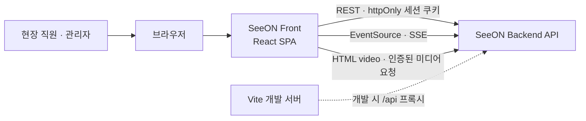
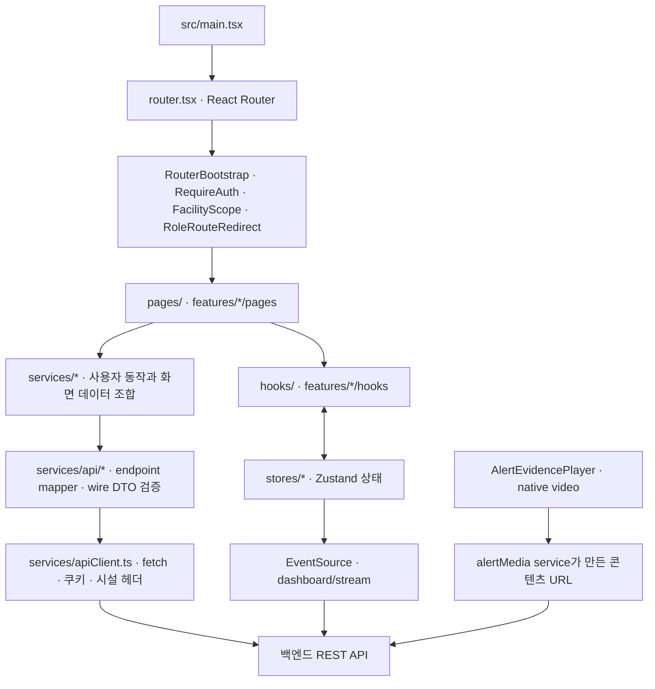
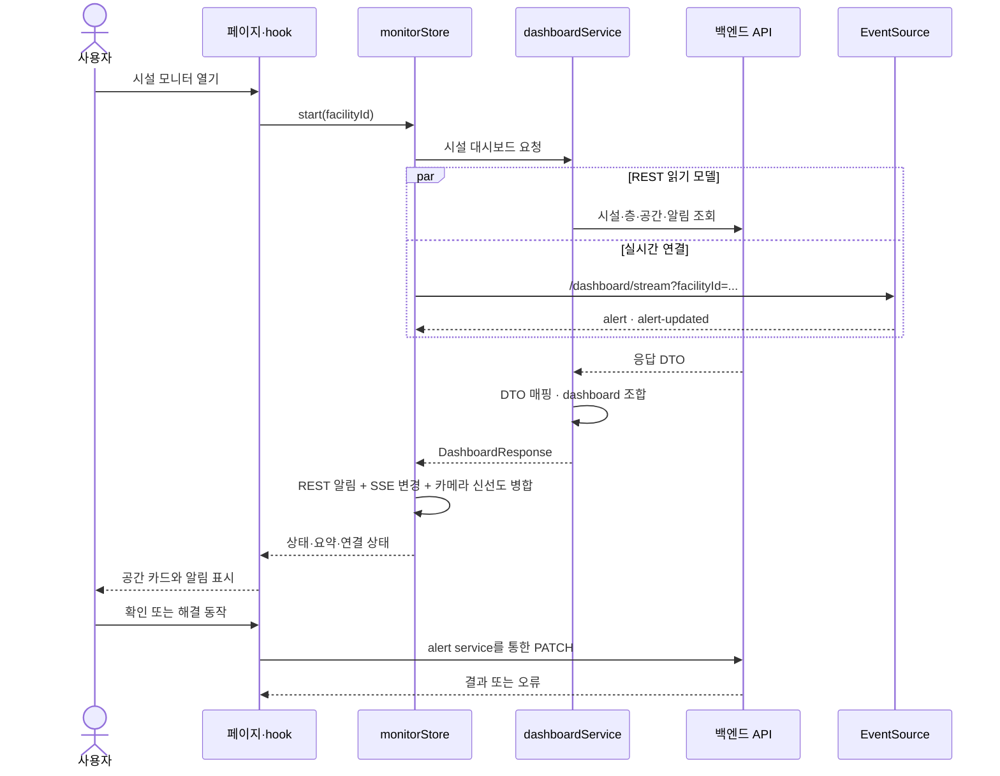

# SeeON Front 아키텍처

이 문서는 `SeeON-Front`의 현재 브라우저 애플리케이션과 API 연결 경계를 설명합니다. 백엔드 구현·배포 환경의 상태를 대신 설명하지 않습니다. HTTP 요청·응답의 기준은 프런트 타입이 아니라 백엔드 OpenAPI입니다. 계약의 위치와 변경 규칙은 [CONTRACT.md](../CONTRACT.md)를 참고하세요.

## 시스템 경계

- 이 프런트엔드는 카메라·엣지 런타임에 직접 연결해 영상을 분석하지 않습니다. 화면은 백엔드 API가 제공하는 시설·공간·알림·연결 상태를 사용합니다.
- 엣지 등록 화면도 백엔드 관리 API를 호출하는 UI입니다. 엣지 자격 검증·저장·실제 설치는 이 저장소의 책임 범위가 아닙니다.
- 정적 SPA 배포와 API 서비스는 별도입니다. Vercel 재작성은 `index.html` 제공 규칙이지 API·SSE·미디어 프록시가 아닙니다.

## 애플리케이션 구성

컴포넌트는 백엔드 URL을 직접 호출하지 않습니다. 화면·hook은 서비스 경계를 사용하고, API endpoint·DTO 해석은 `services/api/`에 둡니다. 기능 내부 코드는 외부에서 해당 feature의 `index.ts`를 통해 사용합니다. 공통 프런트 모델과 백엔드 wire DTO도 분리합니다.

## 주요 화면과 라우트

| 경로 | 사용 범위 | 구현 |
| --- | --- | --- |
| `/login`, `/signup`, `/onboarding` | 세션 진입과 시설 온보딩 | `src/pages/` |
| `/facilities` | 시설 선택 등 상위 관리자 화면 | `SuperAdminDashboardPage` |
| `/facilities/:facilityId/dashboard`, `/facilities/:facilityId/floors`, `/facilities/:facilityId/floor/:floorId`, `/facilities/:facilityId/alerts` | 시설 직원의 모니터·알림 | `features/monitor`, `features/dashboard`, `pages/staff/AlertsPage.tsx` |
| `/facilities/:facilityId/admin/*` | 시설 관리자 기능 | `pages/admin/`, `features/admin-events` |
| `/facilities/:facilityId/admin/edge-enrollment` | 엣지 자격·설치 수명주기 UI | `features/edge-enrollment`; `SUPER_ADMIN` 추가 검사 |

`/dashboard/*`와 `/admin/*`는 레거시 경로 redirect용입니다. 새 기능의 계약 경로로 사용하지 않습니다. 화면 라우트 가드는 UX 계층이며 서버 권한 검사가 아닙니다.

## 요청·인증·시설 경계

| 관심사 | 프런트 구현 | 경계와 의미 |
| --- | --- | --- |
| API 기본 경로 | `VITE_API_BASE_URL`; 미설정 개발 기본값 `/api/v1` | Production 값이 있으면 절대 HTTPS URL이어야 합니다. 미설정 빌드를 허용하는 것은 API 연결을 보장하지 않습니다. |
| 개발 프록시 | `vite.config.ts`의 `/api` → `VITE_DEV_BACKEND_ORIGIN`, 기본 `http://localhost:8080` | 개발 서버 전용 설정이며 브라우저 번들 설정이 아닙니다. |
| HTTP 요청 | `services/apiClient.ts`의 `requestJson`, `requestNoContent`, `requestResponse` | 기본 `credentials: "include"`; 비정상 HTTP 응답은 `ApiError`로 반환됩니다. 컴포넌트에서 직접 `fetch`하지 않습니다. |
| 인증 세션 | `authService`와 `authStore` | 로그인은 백엔드에 위임합니다. 백엔드 httpOnly `app_session` JWT 쿠키를 사용하고 `/auth/me`로 세션을 복원합니다. 프런트 `localStorage` 세션은 없습니다. |
| 시설 스코프 | `facilityStore`, `FacilityScope`, `apiClient` | 현재 선택 시설 ID는 `sessionStorage`에 보관됩니다. 시설 스코프 API 요청에는 `X-Facility-Id`가 추가될 수 있으며, 네이티브 EventSource는 `facilityId` query parameter를 사용합니다. 서버가 시설 접근을 재검증해야 합니다. |
| 역할 가드 | `RequireAuth`, `lib/roles.ts` | 직원·관리자 화면을 라우팅에서 제한합니다. 백엔드 RBAC·시설 가드가 최종 권한 기준입니다. |
| 401 | `apiClient`의 unauthorized handler | 세션 사용자 상태를 지우고 기존 세션이 있었으면 로그인 경로로 보냅니다. 프런트는 토큰을 읽거나 자체 갱신하지 않습니다. |

백엔드 인증·API 계약의 SSOT, 변경 순서, 금지된 우회 방법은 [CONTRACT.md](../CONTRACT.md)와 [SeeON-Backend](https://github.com/SeniorAILab/SeeON-Backend)를 확인하세요.

### 주요 API 표면

경로는 설정된 API base를 기준으로 한 상대 경로입니다. 실제 배포의 제공 여부·권한·요청 스키마는 백엔드 OpenAPI에서 확인해야 합니다.

| 목적 | 프런트가 사용하는 경로·전달 방식 |
| --- | --- |
| 로그인·세션 | `POST /auth/login`, `GET /auth/me`, `POST /auth/logout`, `POST /auth/register` |
| 시설 부트스트랩 | `GET /facilities`, `GET /facilities/:id`, `POST /facilities` |
| 대시보드 기초 데이터 | `GET /facilities/:id`, `GET /floors`, `GET /spaces`, `GET /alerts` |
| 실시간 이벤트 | `GET /dashboard/stream`; 네이티브 `EventSource`가 `alert`, `alert-updated`, `session-invalid` 이벤트를 처리 |
| 알림 상태 변경 | `PATCH /alerts/:id/ack`와 `PATCH /alerts/:id/resolve`는 별개 작업이며 서로 대체하지 않음 |
| 이벤트 근거 미디어 | `GET /alerts/:id/media`, 인증된 `/alerts/:id/media/content`, `POST /alerts/:id/media/access` |

## 데이터와 상태 흐름

`dashboardEndpoints.ts`는 시설·층·공간·알림 읽기를 조합해 대시보드 모델을 만듭니다. `monitorStore`는 그 읽기 모델에 알림 REST 응답과 SSE 변경을 병합하고, 카메라 freshness는 별도로 갱신합니다. `features/monitor/hooks/useRealtimeSpaceStatus.ts`는 화면에 필요한 공간 정렬·요약을 계산합니다. 브라우저에서 모델 추론을 수행하는 경로는 없습니다.

`SpaceStatus.status`(위험 표시)와 `SpaceStatus.connection`(카메라 신선도)은 직교 축입니다. 또한 현황판 SSE 연결 상태 `ConnectionState`(`NORMAL`, `RECONNECTING`, `DELAYED`, `DISCONNECTED`)는 두 공간별 상태와 다릅니다. 하나의 축이 다른 축을 정상으로 덮어쓰지 않도록 유지합니다.

## 상태 소유권

| 상태 | 소유자 | 저장·수명 |
| --- | --- | --- |
| 로그인 사용자 | 백엔드 쿠키가 인증 기준, 프런트 `authStore`는 화면용 사용자 모델 | 쿠키는 백엔드 발급. Zustand 사용자 상태는 런타임에서 복원 |
| 현재 시설 | `facilityStore` | 선택된 시설 ID는 브라우저 `sessionStorage`; 요청 권한은 서버가 검증 |
| 대시보드·실시간 상태 | `monitorStore` | 현재 앱 실행에 필요한 데이터·SSE 연결·시간 정보를 메모리에 둠 |
| 모니터 환경설정 | `features/monitor/stores/monitorSettingsStore.ts` | 브라우저 `localStorage`; 모니터 브라우저 단위 설정이며 서버 권한이나 시설 설정 데이터가 아님 |
| 상호작용 임시 상태 | React 페이지·컴포넌트 | 해당 화면 수명; 서비스 응답의 원본 데이터베이스가 아님 |
| wire/API 모델 | 백엔드 OpenAPI 및 응답 | 프런트 DTO mapper가 검증·정규화해 `src/types/`의 화면 모델로 전달 |

## 실패와 복구

- **HTTP 실패 또는 응답 형식 오류:** API helper는 비성공 응답을 `ApiError`로 내보내고 mapper는 잘못된 응답을 거부합니다. 호출 화면은 실패 상태를 표시해야 하며 오류를 빈 데이터나 성공으로 꾸미지 않습니다.
- **로그인 세션 만료:** HTTP `401`에서 프런트 인증 상태를 비우고 로그인 화면으로 이동합니다. SSE `session-invalid` 이벤트도 현황판 연결을 종료하고 로그아웃을 처리합니다.
- **초기 현황판 요청 실패:** `monitorStore`는 로딩을 끝내고 `RECONNECTING` 상태를 유지합니다. 백엔드 연결이 없는 UI를 정상 데이터로 대체하지 않습니다.
- **SSE 오류:** 연결 상태를 `RECONNECTING`으로 표시하고 활성 알림의 REST 동기화를 대체 경로로 사용합니다. 브라우저가 `EventSource` 재연결을 관리합니다. 네트워크 복귀나 문서 재노출 시 즉시 동기화를 요청합니다.
- **카메라 상태 조회 실패:** 마지막으로 얻은 freshness 값을 유지할 수 있습니다. 따라서 표시된 마지막 상태가 방금 재확인된 상태라고 가정할 수 없습니다.
- **시설 전환 중 늦게 도착한 응답:** 실행 세대와 현재 시설을 확인해 이전 구독의 응답이 새 화면을 덮지 않게 합니다.
- **근거 미디어의 준비·접근·재생 실패:** 화면은 `LOADING`, `PENDING`, `READY`, `UNAVAILABLE`, `EXPIRED`, `DELETED`, `DENIED`, `ERROR` 상태를 구분합니다. 취소된 미디어 요청은 폐기하고 화면 이탈 시 video source를 정리합니다. 브라우저의 네이티브 재생·Range 동작과 서버 권한은 별도 검증 대상입니다.

## 소스 지도

| 위치 | 책임 |
| --- | --- |
| `src/main.tsx`, `src/router.tsx` | React 진입점, URL 라우트와 역할별 화면 구성 |
| `src/components/RequireAuth.tsx`, `FacilityRouteScope.tsx`, `RouterBootstrap.tsx` | 세션 초기화·화면 가드·시설 라우트 범위 |
| `src/pages/`, `src/features/` | route 화면과 feature 모듈 (`dashboard`, `monitor`, `admin-events`, `edge-enrollment`) |
| `src/services/` | 인증·대시보드·이벤트·알림 등 업무 흐름 |
| `src/services/api/` | endpoint 호출, 백엔드 DTO 파싱·도메인 매핑 |
| `src/stores/`, `src/features/*/stores/` | 공유·기능별 Zustand 상태 |
| `src/types/` | UI와 서비스 사이의 정규화된 프런트 도메인 모델 |
| `vite.config.ts`, `.env.example`, `src/vite-env.d.ts` | 개발 프록시·브라우저 환경 계약·변수 타입 |
| `vercel.json`, `.github/workflows/ci.yml`, `package.json` | 정적 SPA 재작성·CI 명령·실행 스크립트 |

저장소 구조 규칙은 [`src/AGENTS.md`](../src/AGENTS.md), 백엔드 API 변경 규칙은 [`CONTRACT.md`](../CONTRACT.md), 정적 배포·이력과 준비 상태는 [`MIGRATION.md`](../MIGRATION.md)에서 확인합니다.

## 범위와 알려진 한계

- 이 문서는 프런트 소스에서 관찰되는 구조를 설명합니다. 실제 Production 백엔드의 CORS·쿠키 속성·RBAC·SSE·미디어 제공, 시설 데이터, 모델 성능을 검증하거나 보증하지 않습니다.
- 프런트 라우트 가드는 사용자 경험을 위한 보조 장치입니다. 서버는 모든 API·미디어 요청의 권한과 시설 스코프를 독립적으로 검사해야 합니다.
- Vercel 정적 배포는 SPA shell 제공 범위입니다. API ingress, SSE, 업로드, 미디어 Range 처리는 별도 HTTPS 백엔드·게이트웨이 구성이 필요합니다. 실 Production URL 검증 전에는 전체 제품 준비 상태를 주장할 수 없습니다.
- 브라우저 음성 합성과 미디어 재생은 브라우저 정책·사용자 제스처·쿠키 및 배포 도메인 설정의 영향을 받습니다.
- 클립 생성·보관·삭제 정책, 모델 판단의 정확도, 가용성 목표와 운영 성능은 이 저장소만으로 판단할 수 없습니다.
